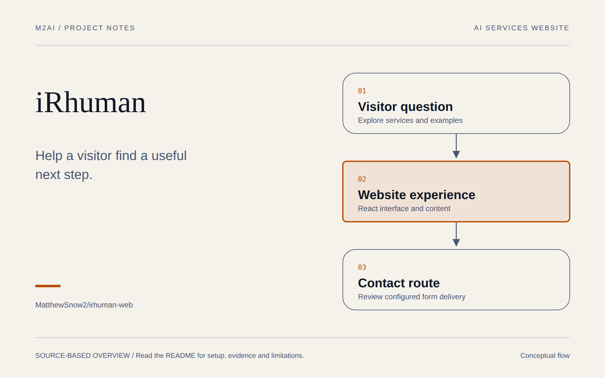

# iRhuman.ai



A business owner should be able to explore an AI service without learning its implementation first. iRhuman.ai presents services through a visual carousel, short sections, voice-agent demo links and a guided audit form, giving a visitor a route from curiosity to a specific conversation.

This repository is the React and TypeScript marketing frontend. It is a brand variation of the author's M2AI_Web2.0 project. It demonstrates service communication, motion, reusable page sections and lead-intake interface design. The source is not evidence of client outcomes or of working delivery behind every advertised service.

## Explore the experience

- Navigate from the image carousel to a matching service section.
- Browse service content and linked voice-agent demos.
- Open the audit modal and inspect how it collects a visitor's needs.
- Use the contact form and responsive layout as starting points for your own brand.

## Run the site

Use Node.js 22 and npm. No Gemini or other model API key is required for the frontend. The former AI Studio template instruction to add a Gemini key did not match the application.

```bash
git clone https://github.com/MatthewSnow2/irhuman-web
cd irhuman-web
npm ci
npm run dev
```

The checked-in Vite configuration serves port 3000 on all interfaces. On ProBook, open [the site](http://10.0.0.46:3000); on another computer, use its LAN address.

For a production build and local preview:

```bash
npm run build
npm run preview -- --host 0.0.0.0 --port 4173
```

Open [the built preview on ProBook](http://10.0.0.46:4173). The build writes `dist/`. Stop the process to end either preview.

## First walkthrough

1. Open the page at a desktop width, click a carousel image and confirm it moves to the intended section.
2. Open the audit modal, move through the fields, then close it. Repeat at a narrow mobile width and check that labels and controls remain readable.
3. Inspect the contact form's validation and error handling using a local development copy. A successful UI message alone does not establish inbox receipt.
4. Before using voice-agent links, replace the public demo destinations with services you control. Opening or interacting with those links uses external services and is not needed to review the frontend.

## Adapt the content

| File | What to change |
| --- | --- |
| [constants.ts](constants.ts) | Carousel images, service copy, form choices and voice demo links |
| [App.tsx](App.tsx) | Page composition |
| [components/sections](components/sections) | Individual service sections |
| [components/AuditModal.tsx](components/AuditModal.tsx) | Audit form and submission handling |
| [components/ContactForm.tsx](components/ContactForm.tsx) | Contact form and submission feedback |
| [tailwind.config.js](tailwind.config.js) | Brand colors and animation tokens |
| [vite.config.ts](vite.config.ts) | Development server and build output |

## Verification and limitations

`npm run build` is the supplied build check. There are no test or lint scripts in `package.json`; do not equate a successful build with accessibility, delivery or browser validation.

Both forms POST URL-encoded data to `/` and use Netlify-style form markup. A static Vite preview does not provide a form-processing backend. Configure and verify a compatible host or backend before collecting leads, then confirm the actual destination receives the submission. This repository has no server-side AI inference service. Remote image and demo availability can change independently of this code.

No license file is included in this snapshot. Confirm source and media reuse rights before redistribution.
